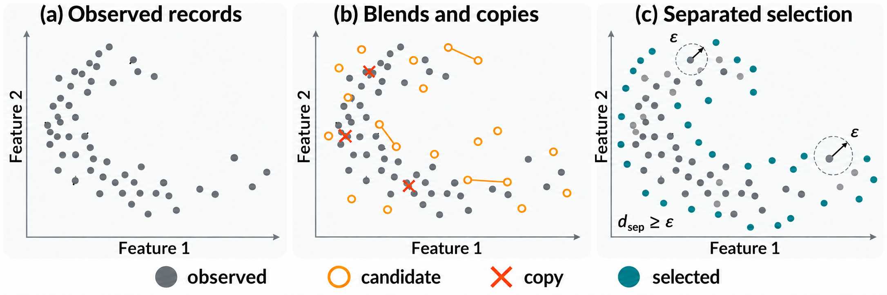
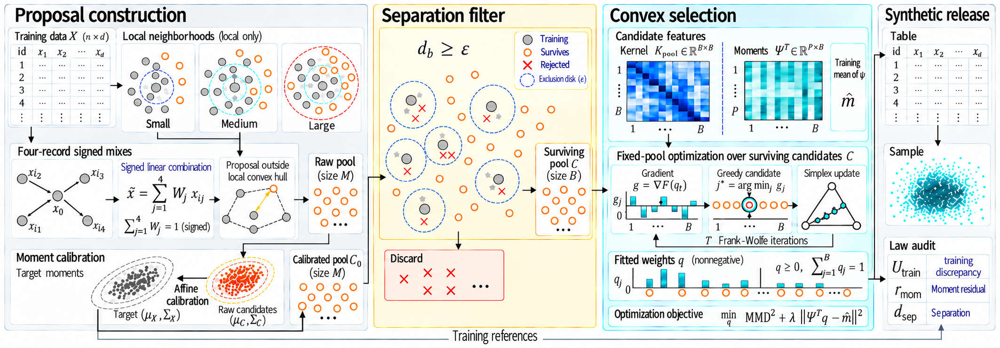
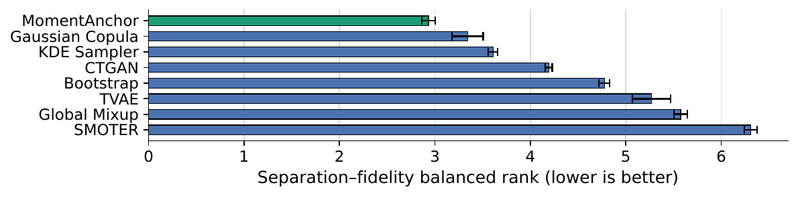

# MomentAnchor

**Local mixes give many candidates. The release is the law you pick on the ones that stay away from training rows.**

MomentAnchor builds a pool of signed local affine mixes, calibrates them toward the training mean and covariance, and drops any candidate inside a recorded radius of a real row. A probability vector on the surviving pool is then chosen by convex kernel-discrepancy minimization with a quadratic penalty on declared moment features. Frank–Wolfe’s linear step is a greedy pick of one candidate. Each fitted law carries an audit of training discrepancy, feature residual, and encoded-support separation.

<p align="center">
  <a href="#quick-start"><strong>Quick start</strong></a>
  &nbsp;·&nbsp;
  <a href="#reproduce-the-tables"><strong>Reproduce</strong></a>
  &nbsp;·&nbsp;
  <a href="#layout"><strong>Layout</strong></a>
</p>

## When mixing is cheap and the fourth moment is not

Two-record affine mixing can keep low-order moments while the coordinate fourth moments move. The gap is why the code measures the moments the finite pool actually attains, then selects on that pool.

<p align="center">
  
</p>

## Filter, then choose a law

Candidates that sit inside the recorded radius are removed. The remaining atoms enter a penalized maximum-mean-discrepancy objective. The audit record belongs to the fitted law. A finite release is a resample from that law, after categorical codes are snapped to training levels.

<p align="center">
  
</p>

## Held-out kernel discrepancy

The primary endpoint is held-out maximum mean discrepancy. The ranking chart is the secondary two-axis summary used in the paper. Encoded-space separation is a geometric diagnostic, not a privacy guarantee.

<p align="center">
  
</p>

## Quick start

Python 3.10+ recommended.

```bash
python -m venv .venv
pip install -r requirements.txt
python scripts/run_benchmark.py --profile smoke
```

Smoke is one table, one seed, and 256 synthetic rows. Tables land in `results/` (gitignored).

## Reproduce the tables

```bash
python scripts/run_benchmark.py --profile full
```

The printed protocol is twelve public regression tables, five seeds, 1024 synthetic rows, and a 2% leave-one-out nearest-neighbor radius that can be zero. Public tables are fetched from OpenML or scikit-learn on first use. They are not stored in this repository.

Frank–Wolfe iteration and moment-order ablations:

```bash
python scripts/run_benchmark.py --ablation fw --seeds 42 43 44
```

```bash
python scripts/run_benchmark.py --help
```

Outputs go under `results/` (gitignored). Runtime depends on CPU, seeds, and tables.

## Layout

```
scripts/           benchmark, tables, figure driver, loaders
docs/figures/      figures used in this README
requirements.txt   Python dependencies
```

## Notes

- The distance filter uses the 2% leave-one-out nearest-neighbor quantile on the training sample. That quantile can be 0.
- A post-fit check refuses a release if the fitted law places weight on a copy of a training row.
- Tabular diffusion was exercised only in preliminary smoke runs and is not in the printed tables.
- `Simplex-LOWEM` is a lineage ablation, not a published baseline.
